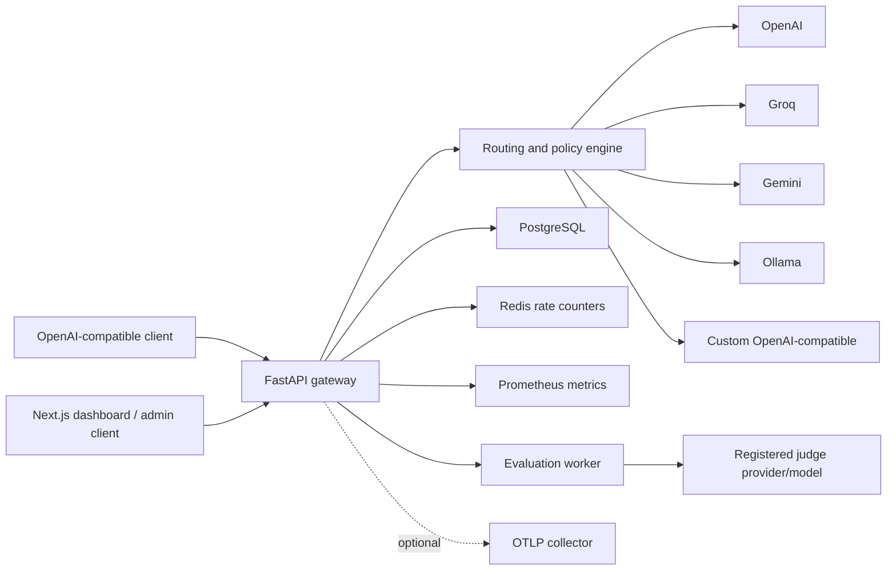

# Architecture

ModelDock adalah control plane single-cluster dengan gateway kompatibel OpenAI, registry konfigurasi, routing terkontrol, observability request, dan dashboard server-rendered.

## Komponen



FastAPI memiliki gateway dan management API. PostgreSQL menyimpan konfigurasi, governance, trace, usage, dan audit. Redis menyimpan rate dan concurrency counter terdistribusi dengan fallback in-process. Next.js memanggil management API dari server sehingga admin key tidak masuk browser JavaScript.

## Alur Request

```text
Authorization dan IP check
  -> RPM dan concurrency check
  -> idempotency replay check
  -> monthly key quota dan project budget check
  -> routing-rule match
  -> virtual/direct model resolution
  -> capability, tag, dan context-window filtering
  -> priority / cheapest / fastest / weighted / deterministic canary ordering
  -> provider concurrency dan circuit breaker filter
  -> provider attempt dengan timeout dan safe retry
  -> fallback kandidat berikutnya
  -> response OpenAI normalization
  -> trace, attempt, token, cost, latency, dan health persistence
```

Request streaming memakai jalur yang sama. OpenAI/Groq/custom meneruskan SSE, Ollama membaca NDJSON, dan Gemini membaca SSE; output ke client tetap OpenAI-compatible SSE.

## Routing dan Policy

- Direct model menghasilkan strategi `static`.
- Virtual model mendukung `priority`, `cheapest`, `fastest`, `weighted_random`, `weighted_score`, dan `canary`.
- Routing rules dievaluasi berdasarkan priority lalu waktu pembuatan.
- Condition mendukung equality, `less_than`, `greater_than`, `in`, dan `contains`.
- Action dapat `route_to`, `deny`, atau menetapkan requirement capability, tag, dan minimum context window.
- Simulation endpoint mengembalikan kandidat terpilih dan kandidat yang ditolak tanpa memanggil provider.
- Canary menghitung lane control/variant dari hash `routing_key`; key sama selalu menghasilkan lane sama.
- Project TokenPress policy diwariskan saat request memakai `modeldock.token_mode=inherit`; request dapat override policy.
- Retry hanya untuk kegagalan sementara; attempt dan fallback tetap berada dalam satu trace.
- Health latency, reliability, model quality, dan cost menjadi metadata routing; circuit-open provider ditolak sampai cooldown selesai.

## Provider Adapter

Adapter menormalisasi request, response, usage, error, health check, dan streaming untuk:

- OpenAI;
- Groq;
- Gemini;
- Ollama;
- custom OpenAI-compatible endpoint.

OpenAI-compatible adapter meneruskan tools, tool choice, dan response format. Credential provider dapat memuat `api_key` dan custom `headers`, lalu dienkripsi sebelum disimpan.

## Governance

- Project API key: HMAC hash, expiry, revocation, rotation, allowlist, RPM, token quota, dan concurrency.
- Budget: batas bulanan project, warning threshold, projected usage, dan blocking sebelum provider call.
- Prompt registry: template, immutable versions, active version, rendering, dan rollback melalui aktivasi versi lama.
- Evaluation: rule checks untuk contains, regex, exact match, length, latency, dan cost; job asynchronous tersimpan durable dan diproses worker. LLM judge memakai provider/model terdaftar dan mengembalikan score/reason.
- Admin: bootstrap key, signed admin session, password hashing, role untuk user administration, dan audit log perubahan.
- Retention: request/attempt dan audit log dapat dipurge berdasarkan umur.

## Data Utama

```text
projects -> environments -> api_keys
providers -> models
projects -> virtual_models
projects -> routing_rules
requests -> request_attempts
projects -> budgets
projects -> prompt_templates -> prompt_versions
requests -> evaluations
admin_users
audit_logs
```

`requests.metadata_json` menyimpan routing decision dan error. Payload request/response hanya disimpan saat `LOG_PAYLOADS=true`.

## Observability

- Trace detail menampilkan lifecycle request, semua provider attempt, dan Decision Receipt replay tanpa provider call.
- Usage API menyediakan summary, timeseries, per-model, per-provider, dan per-project.
- Provider test menyimpan status, waktu pemeriksaan, dan latency terakhir.
- `/metrics` menyediakan metrik request format Prometheus.
- OTLP tracing FastAPI aktif bila `OTEL_EXPORTER_OTLP_ENDPOINT` diisi.

## Deployment

Docker Compose menjalankan API, web, PostgreSQL, Redis, dan evaluation worker. Manifest Kubernetes serta Helm chart menyediakan baseline single-cluster dengan Secret eksternal, HPA, PDB API, worker, dan NetworkPolicy. Production tetap memerlukan HTTPS/Ingress, image registry, database/cache HA, backup jobs, secret manager, autoscaling, dan kebijakan jaringan provider yang sesuai.

## Batas Saat Ini

Belum termasuk OAuth provider, multi-region orchestration, Kubernetes operator, GPU scheduler, managed PostgreSQL/Redis HA, shadow evaluation, tool-call success routing, dan semantic routing. LLM-as-judge tersedia pada v0.2.0 melalui provider/model yang sudah diregistrasikan.

## Competitive Gateway Core

Gateway normalizes OpenAI Chat Completions, OpenAI Responses, and Anthropic Messages into one internal `ChatCompletionRequest`. Provider adapters normalize each upstream response into `ProviderResponse`; protocol formatting happens after routing so retry, budget, cost, and trace behavior stay consistent.

Provider account pools use encrypted per-account credentials and reset-aware quota fields. Router skips accounts with active quota blocks, while provider-level credentials remain backward-compatible fallback. Model catalog sync upserts discovered models without deleting manual records.
